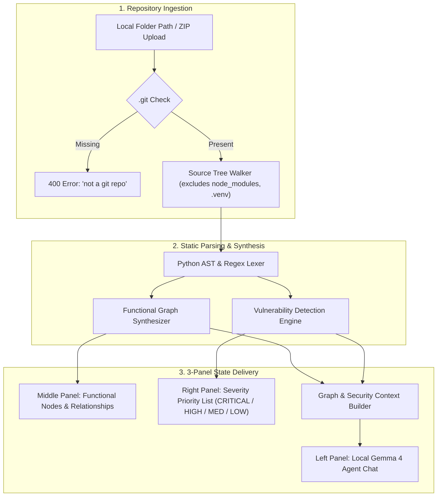
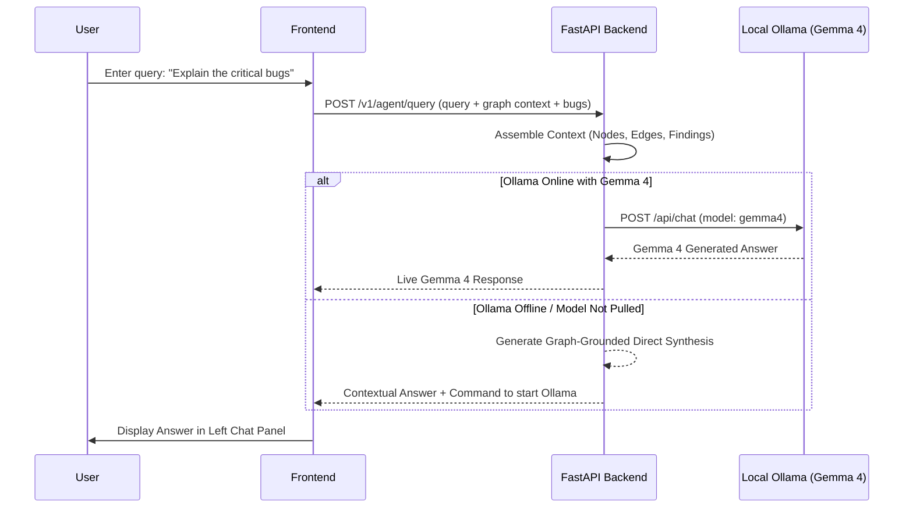

# AegisGraph AI — System Architecture & Technical Specifications

> **System Identity**: Minimal Codebase Functional Knowledge Graph, Bug Prioritizer & Local Gemma 4 Agent  
> **Target Environment**: Local Offline / Developer Workstation  
> **Core Model**: Google's **Gemma 4** via Ollama loopback (`http://127.0.0.1:11434`)

---

## 1. Executive Summary & Under-the-Hood Workflow

AegisGraph AI translates raw repository source code distributed across dozens of files into a **clean, minimal Functional Knowledge Graph** and an **actionable, severity-prioritized vulnerability report**. External AI interaction is powered by a local instance of Google's **Gemma 4** model via Ollama.



---

## 2. Ingestion Pipeline & Git Validation

### `.git` Verification Barrier
To ensure only valid, version-controlled software projects are ingested, the ingestion layer enforces a strict barrier:
* **Directory Path Mode** (`/v1/repo/analyze-local`): Checks `Path(repo_path) / ".git"`.
* **ZIP Archive Mode** (`/v1/repo/upload-zip`): Inspects archive namelist for any `.git` folder entries.
* If `.git` is absent, execution immediately aborts with:
  ```json
  {
    "error_code": "HTTP_400",
    "message": "not a git repo"
  }
  ```

### Filesystem Traversal & Safety Limits
* **Excluded Paths**: `.git`, `node_modules`, `.venv`, `venv`, `dist`, `build`, `__pycache__`, `.next`, `target`, `vendor`.
* **Allowed Source Extensions**: `.py`, `.js`, `.jsx`, `.ts`, `.tsx`, `.html`, `.css`, `.sql`, `.json`, `.yaml`.
* **Per-file Boundary**: Source files exceeding 500 KB are bypassed to prevent memory exhaustion.
* **Max Archive Limit**: Up to 1,500 source files parsed per analysis pass.

---

## 3. Functional Knowledge Graph Construction

Rather than flooding the graph with low-level chunks or hundreds of individual raw tokens, AegisGraph AI maps **high-level functional concepts** that represent what the code actually *does*.

### Concept Grouping & Categorization
1. **Form & Input UI (`UI`)**:
   * Scans for `<form>`, `<button>`, `<input>`, and submission handlers across frontend files.
   * Maps distributed logic (e.g., `form.jsx` + `index.html`) into a single functional node: `"Form & Input UI"`.
2. **API Gateway & Endpoints (`API / Routing`)**:
   * Extracts route decorators (`@app.get`, `@app.post`, `app.use()`, `router.route()`) from controllers and server files.
   * Compiles them into `"API Gateway & Endpoints"`.
3. **Authentication & Access Control (`Authentication`)**:
   * Detects JWT verification, session middleware, role checks, and token handlers.
4. **Database & Persistence (`Storage / DB`)**:
   * Analyzes schema definitions, ORM models, SQL queries, and repository adapters.
5. **Core Business Services (`Service`)**:
   * Identifies calculation engines, workflow orchestrators, and utility adapters.

### Directed Relationships
Edges capture high-level functional dataflow:
* `Form & Input UI` $\xrightarrow{\text{SUBMITS\_TO}}$ `API Gateway & Endpoints`
* `API Gateway & Endpoints` $\xrightarrow{\text{PROTECTED\_BY}}$ `Auth & Access Control`
* `API Gateway & Endpoints` $\xrightarrow{\text{DISPATCHES}}$ `Core Business Services`
* `Core Business Services` $\xrightarrow{\text{QUERIES}}$ `Database & Persistence`

### Line-Level Metadata Provenance
Every functional node records an array of exact locations:
```json
{
  "file": "Phase4/backend/app.py",
  "start_line": 280,
  "end_line": 350
}
```
When clicked in the UI, this metadata reveals where that functionality resides in the project.

---

## 4. Bug & Vulnerability Detection Engine

A deterministic static analysis engine scans code syntax and regex patterns to identify bugs and security vulnerabilities, categorizing them strictly by priority:

| Severity | Category | Detection Mechanism | Example Remediation |
|---|---|---|---|
| **CRITICAL** | Remote Code Execution | Python AST detection of `eval()`, `exec()` | Replace with structured format parsing (`json.loads`) |
| **CRITICAL** | Command Injection | `subprocess.run(..., shell=True)`, `os.system()` | Use argument array with `shell=False` |
| **CRITICAL** | DOM XSS | React `dangerouslySetInnerHTML` | Use `DOMPurify.sanitize()` or standard React text interpolation |
| **HIGH** | Insecure Deserialization | `pickle.loads()` on untrusted input | Migrate to JSON or Protocol Buffers |
| **HIGH** | Unverified SSL/TLS | `requests.get(..., verify=False)` | Enforce CA certificate verification |
| **HIGH** | Hardcoded Secrets | Regex match for API keys, JWTs, and private keys | Move credentials to `.env` or secrets manager |
| **MEDIUM** | Insecure Route Handling | Unauthenticated sensitive endpoints | Apply authentication middleware |

Findings are sorted in priority order (`CRITICAL` > `HIGH` > `MEDIUM` > `LOW`) so developers tackle high-impact issues first.

---

## 5. Local Gemma 4 Agent Integration



### Local AI Execution Details
* **Model**: Google's `gemma4` (supports `gemma4:e4b` (recommended), `gemma4:12b`, `gemma4:26b`, `gemma4:31b`).
* **Connection**: HTTP Loopback to `http://127.0.0.1:11434/api/chat`.
* **Zero Cloud Dependence**: No external API keys or remote calls are made.
* **Offline Fallback Guarantee**: If Ollama is not running, the agent automatically synthesizes an immediate graph-grounded response and provides the exact terminal command to run `gemma4`.

---

## 6. API Reference

### `POST /v1/repo/analyze-local`
* **Request**: `{"path": "C:\\path\\to\\git\\repo"}`
* **Response**:
  ```json
  {
    "repo_name": "my-project",
    "repo_path": "C:/path/to/git/repo",
    "files_scanned": 42,
    "functional_nodes": [
      {
        "id": "fn-form-ui",
        "name": "Form & Input UI",
        "category": "UI",
        "summary": "Interactive user forms and submit buttons",
        "locations": [{"file": "src/form.js", "start_line": 1, "end_line": 65}]
      }
    ],
    "functional_edges": [
      {"source": "fn-form-ui", "target": "fn-api-gateway", "relationship": "SUBMITS_TO"}
    ],
    "vulnerabilities": [
      {
        "id": "a1b2c3d4",
        "severity": "CRITICAL",
        "title": "Shell Injection via subprocess(shell=True)",
        "file": "server.py",
        "line": 84,
        "fix": "Pass arguments as list and set shell=False."
      }
    ]
  }
  ```

### `POST /v1/repo/upload-zip`
* **Request**: `multipart/form-data` with `file: repository.zip`.
* **Behavior**: Validates `.git` inside the ZIP, then returns the same structure as `analyze-local`.

### `POST /v1/agent/query`
* **Request**:
  ```json
  {
    "query": "How is authentication handled in this repository?",
    "repo_name": "my-project",
    "nodes": [...],
    "edges": [...],
    "vulnerabilities": [...],
    "model": "gemma4"
  }
  ```
* **Response**:
  ```json
  {
    "answer": "Authentication is managed by the Auth & Access Control component...",
    "model_used": "gemma4",
    "mode": "ollama_gemma4_live"
  }
  ```

